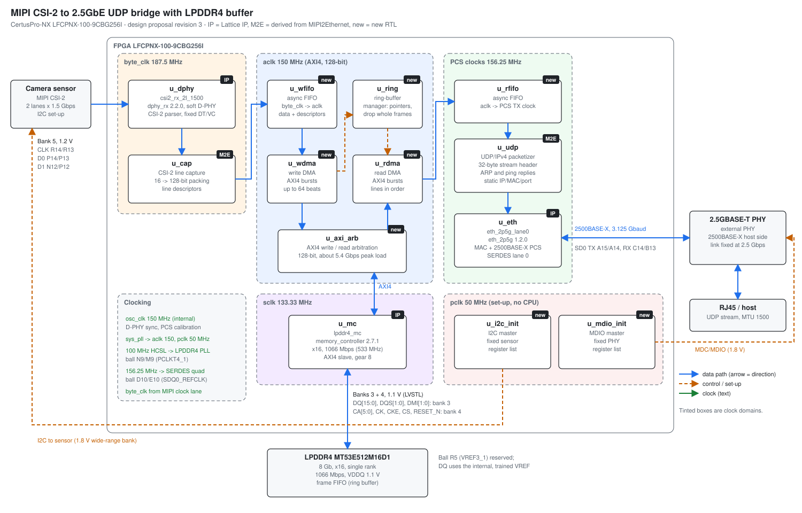

# MIPI CSI-2 to 2.5GbE Bridge with LPDDR4 Buffer (CertusPro-NX)

This FPGA design receives a 2-lane MIPI CSI-2 stream (1.5 Gbps per lane). It buffers the stream in an
external x16 LPDDR4 memory (1066 Mbps), then reads it back and sends it as UDP over 2.5GbE. The FPGA
connects to an external 2.5GBASE-T PHY through 2500BASE-X on one SERDES lane.

- **Target device:** LFCPNX-100-9CBG256I (customer board; no Lattice evaluation board uses this package).
- **Toolchain:** Lattice Radiant 2026.1 with Synplify Pro.
- **Status:** design proposal revision 3 (all questions resolved except Q8, deferred). The pinout
  check build passes (see below); the bridge RTL is not written yet.

## Block diagram



Generated by `scripts/make_diagrams.py` (`python3 scripts/make_diagrams.py`); edit the script, not the SVG file.

## Documents

- [docs/design_proposal.md](docs/design_proposal.md): requirements, architecture, the pinout and bank
  plan (Section 5), clocks, bandwidth, risks and open questions.
- [docs/LFCPNX-100-CBG256_MIPI_Ethernet_LPDDR4_pinout_summary.pdf](docs/LFCPNX-100-CBG256_MIPI_Ethernet_LPDDR4_pinout_summary.pdf):
  A4 summary of the block diagram and the device pinout.
- [docs/references/](docs/references/): Lattice documents used by the proposal:
  - FPGA-DS-02086: CertusPro-NX Family Data Sheet;
  - FPGA-SC-02022: CertusPro-NX 100K pinout CSV (includes CBG256);
  - FPGA-TN-02244: CertusPro-NX High-Speed I/O Interface;
  - FPGA-TN-02090: MIPI D-PHY Bandwidth Matrix;
  - FPGA-IPUG-02127: LPDDR4 Memory Controller IP Core for Nexus Devices (rev 2.2).

## Design basis

- **Earlier MIPI CSI-2 to 2.5GbE bridge (CertusPro-NX Versa Board, no LPDDR4):** the source of the
  CSI-2 receiver, UDP streamer and 2.5GbE blocks to be reused here.
- **FPGA-RD-02278:** the LPDDR4 pin placement on CertusPro-NX.
- **MachXO5-NX 100T Evaluation Board LPDDR4 design:** the x16, 1066 Mbps controller settings for
  the Micron MT53E512M16D1.

## Reproducing the results

All commands run from the repository root with Lattice Radiant 2026.1 (the version recorded in the
`.rdf`); `radiantc` is the Radiant Tcl console.

### Pinout check build (proposal Section 10, step 1)

`src/rtl/pinout_check_top.sv` instantiates the LPDDR4 controller, the CSI-2 receiver and the
2.5GbE IP on the proposed pins (`constraints/pinout_check.pdc`, with ball R5 / VREF3_1
prohibited), with small test logic to keep every path in the netlist. It is not the bridge
design.

1. **Create the project** (only needed if `lscc/pinout_check.rdf` is lost; the script deletes and
   recreates it):

   ```sh
   radiantc scripts/create_project.tcl
   ```

2. **Build:** open `lscc/pinout_check.rdf` in Radiant and run all stages up to Export Files, or
   from the Tcl console:

   ```tcl
   prj_open lscc/pinout_check.rdf
   prj_run_synthesis
   prj_run_map
   prj_run_par
   prj_run_bitstream
   prj_close
   ```

3. **Check timing:** `lscc/impl_1/pinout_check_impl_1.twr` must report no setup or hold errors.

- **IP:** generated for LFCPNX-100-9CBG256I in `src/ip/`:
  - `lpddr4_mc`: `memory_controller` 2.7.1, x16, 8 Gb, 533 MHz;
  - `csi2_rx_2l_1500`: `dphy_rx` 2.2.0;
  - `eth_2p5g_lane0`: `eth_2p5g` 1.2.0, lane 0, SDQ0 reference clock;
  - `sys_pll` and `osc_clk`.

## Verification status (2026-11-05, pinout check build 2)

| Item | Status |
|---|---|
| Pin plan | **Accepted.** All 48 constrained ports placed on the planned balls (checked against `impl_1/pinout_check_impl_1.pad`); R5 shown as PROHIBITED; bank VCCIO 3 = 1.1 V, 4 = 1.1 V, 5 = 1.2 V, others 1.8 V |
| Synthesis, map, place and route, bitstream | Complete: `lscc/impl_1/pinout_check_impl_1.bit` |
| Timing | **Met:** no setup failures at 100 °C or -40 °C, no hold failures |
| Constraint coverage | 99.96%. `mipi_d_p[1:0]` have no input constraint; the soft D-PHY captures them inside the IP (a known open item) |
| Resources | 18% LUT4s, 14% registers, 87 of 208 EBR, 2 of 4 PLLs, oscillator 1 of 1 |
| Hardware | Not tested (no board with this package yet) |

Build 1 failed hold timing (38 endpoints) only because of an over-broad PCS clock definition;
see the comment in `constraints/pinout_check.pdc`.
