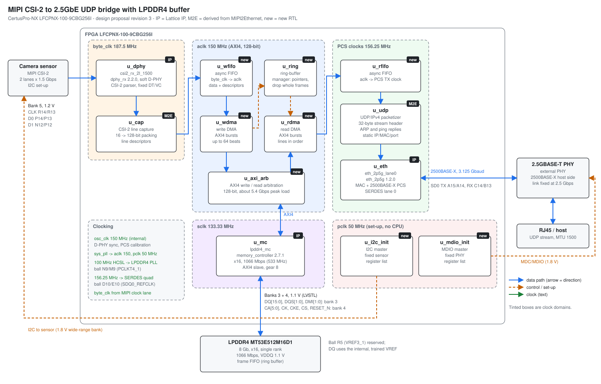

# MIPI CSI-2 to 2.5GbE Bridge with LPDDR4 Buffer on CertusPro-NX: Design Proposal

| Item | Value |
|---|---|
| Revision | 3 (customer answers: all assumptions accepted; Q9 `memory_controller` 2.7.1; Q10 production licences on `lb`; Q8 deferred, pin reserved) |
| Date | 2026-11-05 |
| Status | Draft for review. No RTL written and no build run. |
| Target device | LFCPNX-100-9CBG256I (CertusPro-NX, 100K logic cells, speed grade -9, CBG256, industrial) |
| Toolchain | Lattice Radiant 2026.1, run on the build host `lb` |
| Related project | `../MIPI2Ethernet` (same bridge without LPDDR4, on the Versa Board, LFG672 package) |

## 1. Requirements

| ID | Requirement | Source |
|---|---|---|
| R1 | MIPI CSI-2 input, 2 data lanes, 1.5 Gbps per lane | Request |
| R2 | All received data is first written to an external LPDDR4 buffer: 4 Gb, x16, 1066 Mbps | Request |
| R3 | The memory controller configuration follows the Micron MT53E512M16D1 as used on the Lattice MachXO5-100T evaluation board | Request |
| R4 | Data is read back from LPDDR4 and sent as UDP over one 2.5GbE link | Request |
| R5 | An external PHY provides the 2500BASE-T (2.5GBASE-T) line interface | Request |
| R6 | Device LFCPNX-100-9CBG256I | Request |
| R7 | MIPI receiver configuration is fixed at compile time | Request |
| R8 | External software is out of scope | Request |
| R9 | The pinout must be checked carefully: LPDDR4 and MIPI have different electrical requirements and the package has few pins | Request |

## 2. Summary of findings

1. **The pinout fits without compromise.** CBG256 bonds out all three high-performance (HP) banks.
   - The x16 LPDDR4 interface goes in banks 3 and 4 at VCCIO = 1.1 V.
   - The MIPI receiver gets bank 5 to itself at VCCIO = 1.2 V.
   - The LPDDR4 placement is the x16 subset of the placement Lattice uses on the CertusPro-NX Versa Board (FPGA-RD-02278). All four DQS groups it uses are bonded out in CBG256.
   - The full plan is in Section 5.
2. **LPDDR4 and MIPI must not share a bank.**
   - LPDDR4 (LVSTL) requires VCCIO = 1.1 V.
   - The soft D-PHY with both HS and LP modes requires VCCIO = 1.2 V (FPGA-DS-02086, sysI/O standards table, note 6).
   - Both interfaces can use only banks 3, 4 and 5. Giving each its own banks is therefore a hard rule, not a preference.
3. **1.5 Gbps per lane is the device limit, and it needs both the -9 grade and a flip-chip package.**
   - The data sheet gives 1500 Mbps for MIPI D-PHY HS only in flip-chip packages; wire-bond packages are limited to 1250 Mbps.
   - CBG256 is a flip-chip package (fcCSP, package-type letter "C" in the ordering code).
   - TN-02090 derives 1.5 Gb/s from the -9 input setup and hold times (0.133 ns). The -8 grade (0.167 ns) does not reach 1.5 Gbps.
   - The requested part therefore just qualifies, with no rate margin. The data sheet marks the 1500 Mbps figure "subject to verification when package becomes available" (footnote 8).
4. **The memory density is 8 Gb (resolved, Q1).**
   - MT53E512M16D1 is 512M x 16 = **8 Gb**, not the 4 Gb stated in the request, and the MachXO5-100T board design is configured as 8 Gb (`DDR_DENSITY = 8`).
   - The customer accepted the assumption in revision 2: the design uses the MT53E512M16D1 at 8 Gb, single rank.
5. **The memory and Ethernet bandwidths fit with margin; the risk is a sustained input rate.**
   - The LPDDR4 interface peaks at 17.1 Gbps. The worst-case combined write and read load is about 5.4 Gbps, about 32% of peak.
   - The UDP payload capacity of 2.5GbE (about 2.39 Gbps at a 1500-byte MTU) is below the 3.0 Gbps CSI-2 burst rate.
   - The buffer absorbs bursts, but the sensor's *average* rate must stay below about 2.39 Gbps, or the buffer will eventually overflow (Section 7).
6. **The Ethernet path re-uses proven IP.** `eth_2p5g` 1.2.0 (MAC + PHY on one SERDES lane) is used in the `MIPI2Ethernet` project and in FPGA-RD-02326. The FPGA connects to the external PHY using 2500BASE-X over SERDES lane 0, with the link fixed at 2.5 Gbps. The customer accepted this in revision 2 (Q4), so the chosen PHY must support a 2500BASE-X host interface.

## 3. Precedent and grounding

| Role | Reference | What it provides |
|---|---|---|
| LPDDR4 pin-out and controller (CertusPro-NX) | FPGA-RD-02278 rev B, `/mnt/lscc/devel/LsccRefDesigns/FPGA-RD-02278-...-RevB-250808/` | LPDDR4 placement on CertusPro-NX banks 3 and 4 (DQS groups 54, 102, 114, 150), 100 MHz reference clock on PCLKT4_1 |
| LPDDR4 configuration (x16, 1066 Mbps, MT53E512M16D1) | MachXO5-100T board design, `/mnt/lscc/devel/Boards/MachXO5/MachXO5_100T_LPDDR4/` | `memory_controller` settings: x16, `DDR_CMD_FREQ = 533`, gear 8, `LVSTL_I` / `LVSTLD_I`, read latency 10, write latency 6, 100 MHz reference clock |
| CSI-2 receiver and 2.5GbE | `MIPI2Ethernet` project (based on FPGA-RD-02326) | `dphy_rx` 2.2.0 (2 lanes, 1500 Mbps), `eth_2p5g` 1.2.0, UDP streamer, ARP and control logic. It met timing on LFCPNX-100-9LFG672I, but has not been tested on hardware. |
| Pinout | FPGA-SC-02022 rev 1.0 (CertusPro-NX 100K pinout, includes CBG256) | Ball, bank, DQS group and dual function for every CBG256 pin |
| Electrical rules | FPGA-DS-02086 rev 2.5, FPGA-TN-02244 rev 1.6, FPGA-TN-02090 rev 1.4 | VCCIO per I/O standard, rates per package, DDR pin rules, D-PHY timing |

The pinout file, the data sheet and the two technical notes are stored in `docs/references/`.

- **Note on the pinout download:** the file published on the Lattice website as "CertusProNX-100-CBG256-DD" contains the **50K** pinout (its header says "Pin Out For CertusPro-NX 50K"). It was not used. FPGA-SC-02022 (100K) is the source for every ball in this document.
- **Verified:** for the CertusPro-NX target, `memory_controller` 2.7.1 offers LPDDR4 at x16 or x32, densities of 2, 4, 8 and 16 Gb, and a default command clock of 533 MHz (1066 Mbps).
- **Downloaded but only partly read:** FPGA-IPUG-02127 rev 2.2 (LPDDR4 controller user guide, copy in `docs/references/`).
- **Not yet read:** FPGA-TN-02067 (sysI/O usage guide) and the RD-02278 user guide. Open items that depend on them are marked in Section 9.

## 4. Proposed architecture

```text
                         CertusPro-NX LFCPNX-100-9CBG256I
            ┌──────────────────────────────────────────────────────────────────────────────┐
 CSI-2      │ bank 5 (1.2 V)                                                               │
 2 lanes ──►│ dphy_rx [IP] soft D-PHY + CSI-2 parser ─► line capture ─► write DMA (AXI4 W) │
 1.5 Gbps   │   byte_clk 187.5 MHz, 16-bit             (fixed data type and VC, R7)  │     │
            │                                                                        ▼     │
            │                         ┌────────── memory_controller [IP] ◄── AXI4 ─────┤     │
 LPDDR4 ◄──►│ banks 3+4 (1.1 V) ◄─────┤  LPDDR4 x16, 1066 Mbps, 100 MHz ref clock      │     │
 x16        │                         └────────────────────────────────────── AXI4 ──┐ │     │
            │                                                                        ▼ │     │
            │ ring-buffer manager (write/read pointers, frame and line descriptors)    │     │
            │                                                                        │       │
            │ read DMA (AXI4 R) ─► UDP/IPv4 packetizer + ARP/ping ─► eth_2p5g [IP]   │       │
            │                                                       MAC + PCS, SERDES lane 0 │
            └─────────────────────────────────────────────────────────────┬────────────────┘
                                                                          │ 2500BASE-X, 3.125 Gbaud
                                                                          ▼
                                                    External 2.5GBASE-T PHY ── RJ45 ── host
```



The diagram is generated by `scripts/make_diagrams.py` (`python3 scripts/make_diagrams.py`). Edit the script, not the SVG file.

### 4.1 Blocks

- **CSI-2 receiver:** `latticesemi.com:ip:dphy_rx:2.2.0` (CSI-2/DSI D-PHY Rx, FPGA-IPUG-02081).
  - Parameters from `MIPI2Ethernet`: 2 lanes, 1500 Mbps, gear 8, 150 MHz sync clock, lane alignment on.
  - The data type and virtual channel are fixed at compile time (R7). No runtime configuration path is built.
- **Line capture and write DMA (new RTL):**
  - Packs CSI-2 long-packet payload into 128-bit words, crosses from `byte_clk` to the AXI clock, and writes them to the ring buffer with AXI4 bursts of up to 64 beats.
  - Each completed line writes a descriptor (frame number, line number, length, data type, CSI-2 error flags) to a small on-chip FIFO or to a descriptor area in LPDDR4.
  - The capture logic is derived from `csi2_line_capture` in `MIPI2Ethernet`.
- **LPDDR4 controller:** `latticesemi.com:ip:memory_controller:2.7.1`.
  - Version 2.7.1 was selected by the customer in revision 2 (Q9).
  - Memory type LPDDR4, x16, 1 rank.
  - `DDR_DENSITY = 8` (8 Gb, MT53E512M16D1; Q1 resolved).
  - `DDR_CMD_FREQ = 533` MHz, `GEAR_RATIO = 8`, AXI4 data interface.
  - Timing, latency and ODT settings start from the MachXO5-100T design (read latency 10, write latency 6, preamble 2, postamble 1, fast slew).
  - Proposed AXI data width: 128 bits. This equals the native width of x16 at gear 8, so no width converter is needed in the controller.
- **Ring-buffer manager (new RTL):**
  - Divides the LPDDR4 into a circular buffer and keeps the write and read pointers.
  - Arbitrates AXI write (capture) and read (streaming) traffic.
  - On overflow it drops whole frames, as `MIPI2Ethernet` drops whole lines, and counts the drops.
- **Read DMA and UDP packetizer:**
  - Reads stored lines in order and splits them into UDP datagrams with the 32-byte stream header defined in `../MIPI2Ethernet/docs/udp_protocol.md`. The same format is used here (Q6 accepted).
  - ARP and ping responders are re-used from `MIPI2Ethernet`.
- **Ethernet:** `latticesemi.com:ip:eth_2p5g:1.2.0`, `IP_OPTION = MAC + PHY`, `SPEED_SEL = 16-bit GMII`, SERDES lane 0 (`SD0`), PMA reference clock from `SDQ0_REFCLK`. `FRAME_TYPE` stays at "Super Jumbo" (8192-deep frame buffer): in version 1.2.0 it is not an editable parameter (`ip_get_parameters` reports `editable: false`, and ipgen ignored a "Standard" setting). The 1500-byte MTU (Q6) is enforced by the packetizer instead.
- **PHY management:** the external PHY needs to be set up over MDIO, at a minimum for host-interface mode, link and reset. With no software (R8), a small MDIO state machine writes a fixed register list after reset. The list depends on the PHY part, which has not been chosen yet.

## 5. Pinout and bank plan

### 5.1 Facts about the LFCPNX-100 in CBG256

From FPGA-SC-02022 and FPGA-DS-02086:

- **User I/O:** 165 in total.
  - 84 HP I/O in banks 3, 4 and 5.
  - 75 wide-range I/O in banks 0, 1, 2, 6 and 7.
  - 6 ADC inputs.
  - 4 SERDES lanes (SD0 to SD3, one quad).
- **HP banks.** Each HP bank consists of whole 12-pin DQS groups:

| Bank | HP I/O | DQS groups bonded out | VREF pins | PCLK inputs |
|---|---|---|---|---|
| 3 | 24 | 114, 150 | VREF3_1 = PB110A (R5), VREF3_2 = PB156B (M1) | PCLKT3_0..3 |
| 4 | 24 | 54, 102 | VREF4_1 = PB50A (K10), VREF4_2 = PB108B (T5) | PCLKT4_0..3 |
| 5 | 36 | 6, 30, 42 | VREF5_1 = PB2A (K15), VREF5_2 = PB48B (M11) | PCLKT5_0..3 |

- **Rules that drive the plan:**
  - LPDDR4 DQ, DQS, DMI, CA, CK and control must be in HP banks (3, 4, 5) at VCCIO = 1.1 V (LVSTL_I / LVSTLD_I, 1066 Mbps; DS-02086).
  - A soft D-PHY with HS and LP modes must be in an HP bank at VCCIO = 1.2 V. HS mode alone allows 1.1 or 1.2 V, but LP mode needs 1.2 V (DS-02086, sysI/O table note 6).
  - LPDDR4 needs two data DQS groups for x16, plus one DQS group for CA[5:0] and one for control and CK (TN-02244 Section 6.2.1).
  - VREF1 of a bank that holds DQ/DQS/DM must not be assigned to a signal (TN-02244, pin placement rules).
  - The D-PHY clock lane should enter on a PCLK input (TN-02090 Table 7.7).
  - Differential *inputs* exist only in banks 3, 4 and 5 (DS-02086, note 4).

### 5.2 Bank voltage plan

| Bank | VCCIO | Use |
|---|---|---|
| 3 | **1.1 V** | LPDDR4 data, bytes 0 and 1 |
| 4 | **1.1 V** | LPDDR4 CA, CK, CKE, CS, RESET_N, 100 MHz reference clock |
| 5 | **1.2 V** | MIPI D-PHY clock and 2 data lanes; 30 spare pins (1.2 V LVCMOS12H GPIO only) |
| 0 | **1.8 V** (Q7) | SPI configuration flash (MCLK, MCSN, MOSI, MISO, MD2, MD3), INITN, DONE, PROGRAMN |
| 1 | **1.8 V** (Q7) | JTAG and slave configuration pins; 25 I/O in total |
| 2, 6, 7 | **1.8 V** (Q7) | MDC/MDIO, PHY reset and interrupt, sensor I2C, sensor reset, clock enable, LEDs |
| VCCAUXH3/4/5 | 1.8 V | HP bank auxiliary supplies (DS-02086) |

### 5.3 Proposed ball assignment

The LPDDR4 assignment repeats the bit order of RD-02278 bytes 0 and 3, with one change. DQ15 moves from PB110A to PB118A, so that VREF3_1 stays free (TN-02244). RD-02278 uses VREF3_1 as DQ31; see Q8.

| Signal | Pad | Ball | Bank | DQS group | I/O type |
|---|---|---|---|---|---|
| DQ0 | PB146B | N3 | 3 | 150 | LVSTL_I |
| DQ1 | PB148B | P2 | 3 | 150 | LVSTL_I |
| DQ2 | PB146A | M3 | 3 | 150 | LVSTL_I |
| DQ3 | PB148A | N2 | 3 | 150 | LVSTL_I |
| DQ4 | PB152B | M4 | 3 | 150 | LVSTL_I |
| DQ5 | PB152A | L4 | 3 | 150 | LVSTL_I |
| DQ6 | PB156A | M2 | 3 | 150 | LVSTL_I |
| DQ7 | PB154B | L2 | 3 | 150 | LVSTL_I |
| DMI0 | PB156B | M1 | 3 | 150 | LVSTL_I |
| DQS0_t / DQS0_c | PB150A / PB150B | P1 / N1 | 3 | 150 | LVSTLD_I |
| (spare: pseudo power pad) | PB154A | L3 | 3 | 150 | - |
| DQ8 | PB118B | P4 | 3 | 114 | LVSTL_I |
| DQ9 | PB112B | P5 | 3 | 114 | LVSTL_I |
| DQ10 | PB116A | M5 | 3 | 114 | LVSTL_I |
| DQ11 | PB116B | N4 | 3 | 114 | LVSTL_I |
| DQ12 | PB110B | R4 | 3 | 114 | LVSTL_I |
| DQ13 | PB120B | R3 | 3 | 114 | LVSTL_I |
| DQ14 | PB120A | R2 | 3 | 114 | LVSTL_I |
| DQ15 | PB118A | P3 | 3 | 114 | LVSTL_I |
| DMI1 | PB112A | N5 | 3 | 114 | LVSTL_I |
| DQS1_t / DQS1_c | PB114A / PB114B | T3 / T4 | 3 | 114 | LVSTLD_I |
| (VREF3_1, left unassigned) | PB110A | R5 | 3 | 114 | - |
| CA0 | PB50A | K10 | 4 | 54 | LVSTL_I |
| CA1 | PB50B | L10 | 4 | 54 | LVSTL_I |
| CA2 | PB52A | P10 | 4 | 54 | LVSTL_I |
| CA3 | PB52B | R10 | 4 | 54 | LVSTL_I |
| CA4 | PB54A | T10 | 4 | 54 | LVSTL_I |
| CA5 | PB54B | T9 | 4 | 54 | LVSTL_I |
| CKE | PB56A | R9 | 4 | 54 | LVSTL_I |
| CS | PB56B | P9 | 4 | 54 | LVSTL_I |
| DDR reference clock, 100 MHz (P / N) | PB58A / PB58B | N9 / M9 | 4 | 54 (PCLKT4_1) | LVSTLD_I, HCSL oscillator, DC-coupled |
| CK_t / CK_c | PB100A / PB100B | P8 / R8 | 4 | 102 | LVSTLD_I |
| RESET_N | PB98A | L7 | 4 | 102 | Set by the controller IP |
| MIPI clock lane (P / N) | PB40A / PB40B | R14 / R13 | 5 | 42 (PCLKT5_2) | MIPI_DPHY / LVCMOS12H |
| MIPI data lane 0 (P / N) | PB38A / PB38B | P14 / P13 | 5 | 42 | MIPI_DPHY / LVCMOS12H |
| MIPI data lane 1 (P / N) | PB44A / PB44B | N12 / P12 | 5 | 42 | MIPI_DPHY / LVCMOS12H |
| 2500BASE-X TX (P / N) | SD0_TXDP / SD0_TXDN | A15 / A14 | SERDES | - | AC-coupled to the PHY |
| 2500BASE-X RX (P / N) | SD0_RXDP / SD0_RXDN | C14 / B13 | SERDES | - | AC-coupled from the PHY |
| SERDES reference clock, 156.25 MHz (P / N) | SDQ0_REFCLKP / SDQ0_REFCLKN | D10 / E10 | SERDES | - | Dedicated reference clock input |

The MIPI I/O types follow the `MIPI2Ethernet` constraints (`MIPI_DPHY` on the P pin, `LVCMOS12H` on the N pin), which Radiant accepted for the same IP.

### 5.4 Pin budget

| Group | Pins available | Used | Remaining |
|---|---|---|---|
| Bank 3 (1.1 V) | 24 | 22 LPDDR4 + VREF3_1 | 1 (pseudo power pad) |
| Bank 4 (1.1 V) | 24 | 13 (CA, control, CK, RESET_N, reference clock) | 11 (9 in group 102 and 2 in group 54: spacer or pseudo power pads) |
| Bank 5 (1.2 V) | 36 | 6 | 30 (1.2 V only; spare MIPI lanes or 1.2 V GPIO) |
| Wide-range banks 0, 1, 2, 6, 7 | 75 | Configuration and JTAG about 15; PHY and sensor control about 8 to 10 | About 50 |
| SERDES lanes | 4 | 1 | 3 |

### 5.5 Points for the board designer

- **Separate supplies:** VCCIO3 and VCCIO4 (balls R1, T2, R7, T11) on a 1.1 V rail, which is also the LPDDR4 VDDQ. VCCIO5 (R16, T15) on a separate 1.2 V rail.
- **DDR reference clock:** 100 MHz HCSL oscillator, DC-coupled with 49.9 Ω to ground (TN-02244 Section 6.4.2.1). An LVDS oscillator would need AC coupling and a DC bias network, because LVDS exceeds the 1.1 V VCCIO.
- **SERDES reference clock:** 156.25 MHz differential oscillator on SDQ0_REFCLK (as in RD-02326). A 125 MHz option should be checked against the `eth_2p5g` PMA settings, if the PHY can supply that frequency instead.
- **VREF3_1 (R5):** reserved and left unassigned in the FPGA design (revision 2). Whether the board must supply a reference voltage on it is still open (Q8, deferred), so the schematic should allow either.
- **SERDES lane:** SD0 is proposed. Any of SD0 to SD3 can be chosen to ease PCB routing to the PHY; it is a single `LANE_ID` change.
- **D-PHY routing:** route the D-PHY pairs to MIPI D-PHY impedance rules. The FPGA's internal 100 Ω differential termination is used (TN-02090 Table 6.2), so no external termination resistors are needed.

### 5.6 Alternative not recommended

The Versa Board powers its MIPI camera bank from 1.1 V (VCCIO4_1V1 in FPGA-EB-02053), and the data sheet allows D-PHY **HS** mode at 1.1 V. Running MIPI and LPDDR4 at 1.1 V would therefore save a supply rail. It is not recommended:

- LP mode (LVCMOS12 receive) is specified only at VCCIO = 1.2 V.
- In CBG256, bank 5 is otherwise unused, so the separate rail costs no pins.

## 6. Clock plan

| Clock | Frequency | Source | Use |
|---|---|---|---|
| `serdes_refclk` | 156.25 MHz | External oscillator to SDQ0_REFCLK | 2500BASE-X PMA (3.125 Gbaud) |
| `eth_clk` | 156.25 MHz | `eth_2p5g` TX clock | MAC / GMII side, UDP packetizer |
| `ddr_refclk` | 100 MHz | External HCSL oscillator to PCLKT4_1 | `memory_controller` PLL |
| LPDDR4 edge clock | 533.33 MHz | Controller PLL (x16/3) | LPDDR4 I/O |
| `sclk` | 133.33 MHz | Edge clock / 4 | Controller core |
| `aclk` | 150 MHz (proposed) | PLL | AXI4 between the DMAs and the controller |
| `byte_clk` | 187.5 MHz | MIPI clock lane (1500 Mbps / 8) | CSI-2 receiver output |
| `osc_clk` | 150 MHz | Internal oscillator | D-PHY sync clock, PCS calibration clock |

- **PLL use:** about 3 of the 4 general-purpose PLLs (the controller, AXI or system clocks, and Ethernet). The MachXO5 LPDDR4 design uses 2 PLLs, and `MIPI2Ethernet` uses 1.
- **Constraint coverage:** every clock must be declared in the `.pdc` (and the `.sdc` for synthesis), and the timing report must show 100% constraint coverage.

## 7. Bandwidth and buffer

| Quantity | Value |
|---|---|
| CSI-2 line rate, 2 x 1.5 Gbps (burst, during active lines) | 3.0 Gbps |
| 2.5GbE UDP payload, 1500-byte MTU (1472 of 1538 bytes on the wire) | about 2.39 Gbps |
| 2.5GbE UDP payload, 9000-byte jumbo frames | about 2.48 Gbps |
| LPDDR4 peak, 16 bits x 1066.67 Mbps | 17.07 Gbps |
| Worst-case LPDDR4 load (3.0 Gbps write + 2.39 Gbps read) | about 5.4 Gbps (about 32% of peak) |
| AXI capacity at 128 bits x 150 MHz | 19.2 Gbps per direction |

- **Memory efficiency:** the stream uses long, sequential bursts, which suits LPDDR4. Refresh, read/write turnaround and bank conflicts must still leave more than about 32% of peak. This is expected but must be confirmed by simulation and on hardware.
- **Buffer depth:** if the average input exceeds the Ethernet payload rate, the buffer fills at the difference. At a sustained excess of 0.6 Gbps (3.0 in, 2.39 out), 4 Gb fills in about 7 s and 8 Gb in about 14 s. Bursts and blanking within that budget are absorbed completely.
- **Sizing example:** a 1920 x 1080 RAW12 stream at 60 fps averages 1.49 Gbps, which drains continuously with no build-up.
- **Accepted assumption (Q2):** the sensor's average rate stays below 2.39 Gbps, and every CSI-2 long-packet type is passed through unchanged.

## 8. Resource estimate (to be confirmed by a build)

| Contribution | Basis | LUT4 | Registers | EBR | PLL |
|---|---|---|---|---|---|
| CSI-2 receiver, UDP streamer, 2.5GbE, ARP/control | `MIPI2Ethernet` build 6 on LFCPNX-100 | about 14% | about 12% | 85 of 208 (62 of them in `eth_2p5g` "Super Jumbo") | 1 |
| LPDDR4 x16 controller, including a RISC-V traffic generator | MachXO5-100T board design (same 100K-class Nexus fabric) | 17% | 12% | not measured | 2 |

- **Logic:** the total is expected to be below 35% of LUT4s, because the MachXO5 figure includes a CPU and traffic generator that are not needed here.
- **Block RAM:** EBR is the resource to watch. The `MIPI2Ethernet` line FIFO can shrink because LPDDR4 now holds the data, but the Ethernet frame buffer cannot be reduced in `eth_2p5g` 1.2.0 (FRAME_TYPE is fixed).

## 9. Risks

| Risk | Impact | Mitigation |
|---|---|---|
| D-PHY at 1500 Mbps is the -9 flip-chip limit, and the data sheet marks the package figure "subject to verification" | Bit errors or timing failure at the full rate | Keep the -9 grade; follow the PCLK and same-bank placement; confirm with a pinout test build early |
| LPDDR4 at 1066 Mbps on CertusPro-NX is not shown in hardware by any local design: RD-02278 is on CertusPro-NX, and the 1066 Mbps x16 design is on MachXO5 | Training failure or timing failure | `memory_controller` 2.7.1 is selected (Q9), with the MachXO5 settings. The `MIPI2Ethernet` proposal reports an LMMI clock limit (64.9 MHz) with version 2.6.0 that held RD-02278 builds to 800 Mbps. Build and simulate the 2.7.1 example design on the target device first, to show that this limit does not apply. |
| PHY host interface | The link does not come up if the PHY cannot run 2500BASE-X | The chosen PHY must have a 2500BASE-X host interface; the link is fixed at 2.5 Gbps (Q4 accepted) |
| PHY set-up without software | The PHY needs register writes after reset | MDIO initialisation state machine with a register list from the PHY data sheet |
| No hardware platform with this package | Pinout errors are found only on the customer board | A pinout-only Radiant build to check legality, an early I/O review of the schematic, and bring-up of each interface in turn |
| VREF3_1 handling (TN-02244 says reserve it; RD-02278 uses it as DQ) | Wrong board connection | The pin is reserved in the FPGA design. Q8 is deferred by the customer, but it must be resolved from FPGA-IPUG-02127 before the schematic is released. |

## 10. Verification plan

1. **Pinout check build:** a Radiant project for LFCPNX-100-9CBG256I with the controller, `dphy_rx` and `eth_2p5g` instantiated and the Section 5 constraints. This confirms that the placer accepts every bank voltage, DQS group and PCLK choice before the board is designed.
2. **RTL simulation (Questa, through MCP):**
   - the controller's own example design with the LPDDR4 memory model;
   - a system testbench: CSI-2 receiver output, DMA, a memory model, read DMA, UDP and MAC, with a self-checking test pattern at the full 3.0 Gbps burst rate and an overflow case.
3. **Full build with hard gates:** no setup or hold violations, and 100% constraint coverage (`validate_timing`).
4. **Hardware bring-up**, on the customer board, in this order:
   1. LPDDR4 training and a memory test;
   2. 2.5GbE link through the PHY with an internal test pattern;
   3. MIPI capture;
   4. end-to-end capture with a packet capture tool and a checking script.

## 11. Open questions

**Resolved in revision 2 (customer answers, 2026-11-05):**

| ID | Question | Decision |
|---|---|---|
| Q1 | Memory density | Assumption accepted: 8 Gb (MT53E512M16D1), single rank |
| Q2 | Sensor format and average rate | Assumption accepted: any CSI-2 long-packet type passes through unchanged; the average rate stays below 2.39 Gbps |
| Q4 | PHY host interface and link speeds | Assumption accepted: 2500BASE-X, link fixed at 2.5 Gbps |
| Q9 | Controller version | `memory_controller` 2.7.1. That it reaches 1066 Mbps on CertusPro-NX is still to be shown by the example-design build (Section 12). |

**Deferred:**

| ID | Question | Status |
|---|---|---|
| Q8 | **VREF3_1:** must the board provide a reference voltage on R5 for LPDDR4, or is the controller's internal reference used? (To be read in FPGA-IPUG-02127.) | To be addressed later. The pin is reserved: it is left unassigned in the constraints and no signal may use it. |

**Resolved in revision 3 (customer answers, 2026-11-05):**

| ID | Question | Decision |
|---|---|---|
| Q3 | Buffer policy | Assumption accepted: pure FIFO, streamed as fast as possible; whole frames are dropped on overflow |
| Q5 | Sensor and PHY set-up | Assumption accepted: fixed I2C (sensor) and MDIO (PHY) register lists in the FPGA, no soft CPU |
| Q6 | Network | Assumption accepted: static destination IP, MAC and port set at compile time; 1500-byte MTU; `MIPI2Ethernet` stream header |
| Q7 | Board I/O | Assumption accepted: 1.8 V control I/O; SPI configuration flash in bank 0 |
| Q10 | Licensing | Production licences for the IP cores are available on the build host `lb` (customer statement; not checked against the licence file) |

There are no open questions left except Q8 (deferred).

## 12. Next steps

1. Create the Radiant project in the standard layout and run the pinout check build (Section 10, step 1), with VREF3_1 (R5) reserved.
2. Generate the `memory_controller` 2.7.1 example design for LFCPNX-100-9CBG256I (x16, 8 Gb, 533 MHz), then build and simulate it. This shows that 2.7.1 reaches 1066 Mbps on CertusPro-NX.
3. Resolve Q8 before the schematic is released.
4. Port the CSI-2, UDP and Ethernet blocks from `MIPI2Ethernet`, add the DMA and ring-buffer logic, and simulate the full path.

## 13. Standards and references

**Standards**

- MIPI Alliance CSI-2, and D-PHY v1.2 (the version the CertusPro-NX soft D-PHY complies with, per DS-02086 Section 2.13.5).
- JEDEC JESD209-4 (LPDDR4).
- IEEE 802.3:
  - 802.3bz, 2.5GBASE-T (Clauses 125 and 126): implemented by the external PHY;
  - 2.5GBASE-X PCS (Clause 127): FPGA to PHY.
- IETF RFC 768 (UDP), RFC 791 (IPv4), RFC 826 (ARP), RFC 792 (ICMP).
- RoHS: the CBG256 ordering code "G" denotes RoHS 6/6 (DS-02086, ordering information).

**Lattice documents (copies in `docs/references/` where noted)**

- FPGA-DS-02086 rev 2.5: CertusPro-NX Family Data Sheet (copy).
- FPGA-SC-02022 rev 1.0: CertusPro-NX 100K pinout (copy).
- FPGA-TN-02244 rev 1.6: CertusPro-NX High-Speed I/O Interface (copy).
- FPGA-TN-02090 rev 1.4: MIPI D-PHY Bandwidth Matrix and Implementation (copy).
- FPGA-IPUG-02127 rev 2.2: LPDDR4 Memory Controller IP Core for Nexus Devices (copy). Section 2.4.1.5 describes MC-side DQ_Vref training, relevant to Q8.
- FPGA-IPUG-02081: CSI-2/DSI D-PHY Rx IP.
- FPGA-TN-02067: sysI/O Usage Guide for Nexus Platform (not yet read).
- FPGA-RD-02278 rev B: CertusPro-NX RISC-V and LPDDR4 Memory Controller Reference Design.
- FPGA-RD-02326 rev 1.7: Customizable HSB Sensor Interfaces on CertusPro-NX (copy in `../MIPI2Ethernet/docs/references/`).
- FPGA-EB-02053 rev 1.5: CertusPro-NX Versa Board User Guide.

## 14. Pinout check build result (2026-11-05)

Section 10, step 1 was run with Radiant 2026.1. The project is `lscc/pinout_check.rdf`, the top level is `src/rtl/pinout_check_top.sv` and the constraints are in `constraints/pinout_check.pdc`. Build 2 passes; `Readme.md` has the steps to reproduce it.

- **Pin plan accepted.** All 48 constrained ports are placed on the Section 5.3 balls, with the planned I/O types (LVSTL_I, LVSTLD_I and MIPI_DPHY). R5 (VREF3_1) is reported as PROHIBITED, and the bank voltages are as in Section 5.2.
- **Timing met** at every corner (setup at 100 °C and -40 °C, and hold). Constraint coverage is 99.96%; the MIPI data inputs are the gap (see `Readme.md`).
- **Edge clocks at their limit.** The achieved frequency of the MIPI edge clock (750 MHz target) is 750.75 MHz, and of the LPDDR4 edge clock (533.33 MHz target) is 533.6 MHz. Both figures are the device's edge-clock limits, not logic paths. This confirms Section 2: 1500 Mbps and 1066 Mbps are the -9 maximums, with no rate margin.
- **Q8 evidence.** Map changed `BANK_VREF` on the LPDDR4 DQ pins to the internal reference (`REF_INT`). FPGA-IPUG-02127 Section 2.4.1.5 describes the controller training its own DQ reference (MC-side DQ_Vref training). Together these indicate that R5 needs no external reference. Q8 stays deferred until the board requirements in the guide have been read.
- **Primary clocks are fully used.** All 16 primary clock networks (64 of 64 quadrant spines) are in use: 8 clocks, 6 reset or control nets of the IPs, and 2 constant (GND) nets. The full bridge must add its logic on existing clocks (`aclk`, `byte_clk`, the PCS clocks), not new ones.
- **Resources (pinout check, with the IPs and test logic only):** 18% LUT4s, 14% registers, 87 of 208 EBR, 2 of 4 PLLs.
- **Correction found during generation:** `eth_2p5g` 1.2.0 does not allow `FRAME_TYPE` to be changed (Section 4.1 updated).
